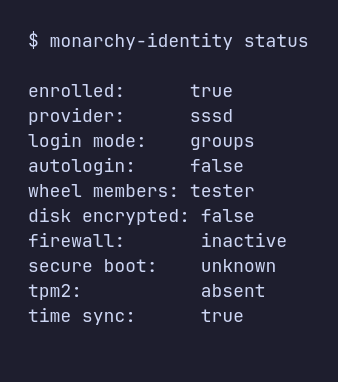
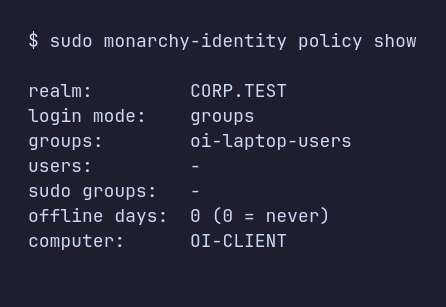
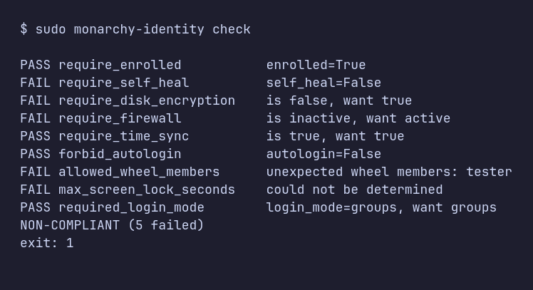
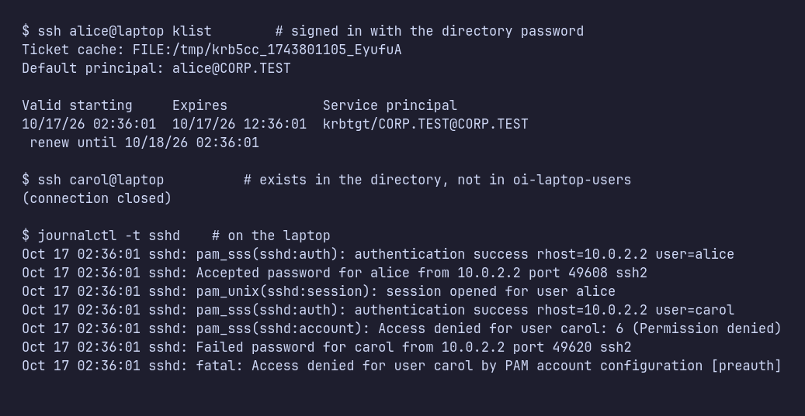
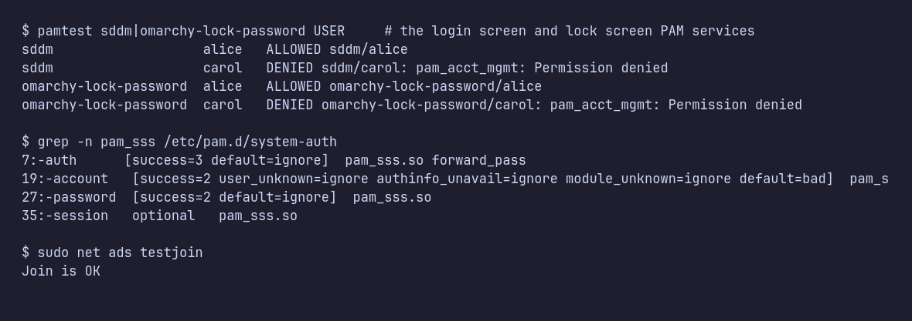
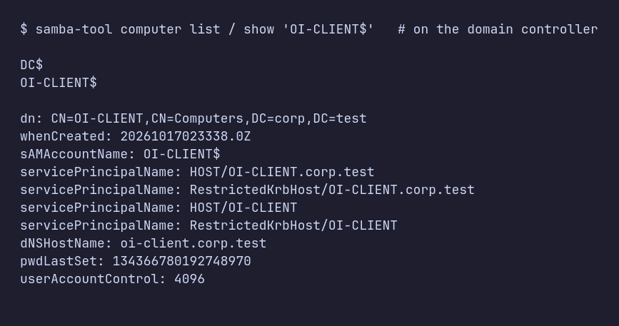
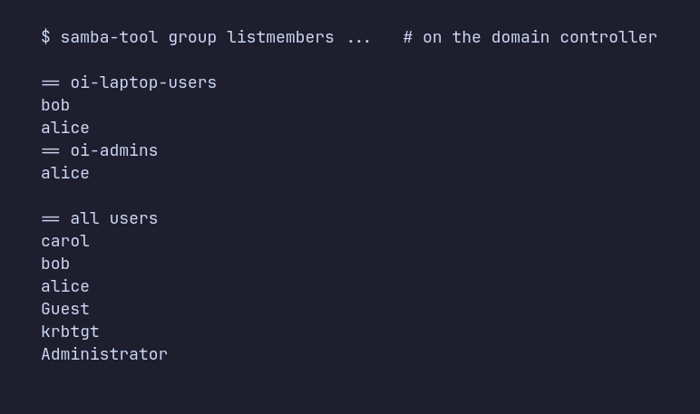
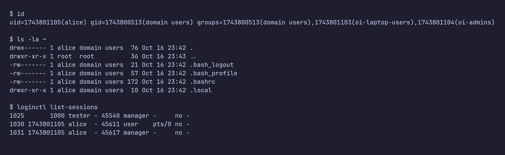
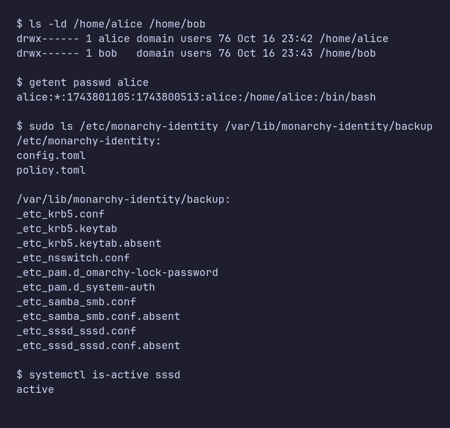

# Administrator guide

For people rolling `monarchy-identity` out to a fleet of Omarchy laptops. Status: prototype, verified in a VM
against Samba AD (see [known limits](#12-known-limits)).

**Contents:** 1 Scope · 2 Plan · 3 Install · 4 Safety rules · 5 Enrol · 6 Login policy · 7 Automation ·
8 Verify and monitor · 9 What keeps it correct · 10 Failure behaviour · 11 Leave · 12 Known limits · 13 Troubleshooting

**In a hurry?** Do sections 2, 3 and 5 on one test VM first, then a few pilot laptops, then script it (section 7).

## 1. What you get, and what you still own

`monarchy-identity` joins a laptop to your directory, decides who may sign in, keeps that configuration from drifting,
and reports device posture. It does **not** remove local admin rights, enforce a device-wide privilege model or harden
boot; it reports on those (`check`) and leaves enforcement to your MDM or other tooling.

## 2. Plan the rollout (do this before touching a laptop)

**Directory side**
- **A join account with least privilege.** Don't use a Domain Admin. Delegate "create and delete computer objects"
  on one OU (e.g. `OU=Laptops,DC=corp,DC=example,DC=com`) to a dedicated account and use it for `--admin`.
- **An OU for the laptops** and `--ou 'OU=Laptops,DC=...'` so their computer accounts land where your GPO scoping and
  delegation expect them.
- **Security groups** for who may sign in, e.g. `laptop-users` (and `laptop-admins` if you use `--sudo-groups`).
  The default policy is *deny*; an empty or missing group means nobody can sign in.

**Laptop side**
- **A unique hostname per laptop** (at most 15 characters). The hostname becomes the directory computer account.
  `enroll` refuses generic names (`omarchy`, `archlinux`, `localhost`) and over-long ones, because two laptops
  sharing a name would fight over one account. Override with `--computer-name NAME` if you need a different scheme.
- **Reachable DNS** for the directory (SRV records) from wherever you enrol; production should omit `--server` and
  let DCs be discovered. **Clocks must be right**: Kerberos fails beyond about 5 minutes of skew (the posture report
  has a `time_sync` field and `check` has a `require_time_sync` rule).
- **A local fallback account** with a password. Enrolment refuses without one.

**Omarchy specifics**
- Omarchy autologs in the first user by design when the disk is encrypted: the disk passphrase *is* the login. With
  directory sign-in you usually want `--disable-autologin` (or accept autologin and rely on the lock screen). Decide
  deliberately; `check` can enforce it (`forbid_autologin`).
- Omarchy's stock login screen has no username box. Enrolment switches SDDM to a `monarchy-identity` theme (Omarchy's look
  plus a username line); `--keep-login-theme` opts out, at the cost of directory users not being able to sign in
  at the greeter.

**Distribution**
- Build `packaging/PKGBUILD` (`makepkg`) and publish to **your own pacman repository** (`repo-add`, signed) so the fleet
  installs and updates it with `pacman`. Installing does nothing until you enrol.

## 3. Install

    sudo pacman -S monarchy-identity            # from your repo; or: makepkg -si in packaging/
    sudo pacman -S monarchy-identity-shell      # optional status widget

Docs ship in `/usr/share/doc/monarchy-identity/` (this guide, the posture schema, an example policy).

## 4. Safety rules for the first enrolment on any machine

1. **A local fallback must exist.** Enrolment refuses otherwise (`--allow-no-local-fallback` overrides, don't).
2. **Use the dead-man's switch:** `--confirm-within 10`. If you don't run `sudo monarchy-identity confirm` within 10
   minutes (after proving a directory user can sign in), the machine leaves the domain and restores itself.
3. **Test in a VM first.** PAM mistakes lock people out.
4. A **failed enrolment changes nothing**: it rolls back the machine and removes the computer account it created.

## 5. Enrol

    sudo monarchy-identity enroll sssd --realm CORP.EXAMPLE.COM --admin joinuser \
         --ou 'OU=Laptops,DC=corp,DC=example,DC=com' \
         --mode groups --groups laptop-users --disable-autologin --confirm-within 10
    # reads the join account's password from stdin

After enrolment, `monarchy-identity status` confirms the result:



**Computer accounts are never taken over silently.** If `NAME$` already exists in the directory and this machine
isn't joined with it, `enroll` refuses (that account may belong to a different laptop; joining would reset its password
and break it). For a genuine re-enrolment of the *same* laptop (e.g. after a reinstall) pass
`--replace-computer-account`.

## 6. Who may sign in, and changing it later

| mode       | who can sign in                                   | needs            |
|------------|---------------------------------------------------|------------------|
| `groups`   | members of the listed directory groups            | `--groups a,b`   |
| `assigned` | only the listed users                             | `--users u1,u2`  |
| `any`      | everyone in the directory (explicit opt-in)       | -                |

Local accounts are never governed by this policy, so the break-glass admin keeps working.

**Change policy without re-joining** (no directory credentials, no new computer account):

    sudo monarchy-identity policy show
    sudo monarchy-identity policy set --mode groups --groups laptop-users,contractors
    sudo monarchy-identity policy set --sudo-groups laptop-admins        # '-' removes sudo
    sudo monarchy-identity policy set --offline-days 14



Only the options you pass change. A change that would leave the machine with nobody allowed is refused; if the new
configuration can't resolve its group, the previous policy is restored automatically.

**Admin rights:** `--sudo-groups g1,g2` (at enrolment or via `policy set`) gives those directory groups sudo through a
visudo-validated drop-in (`/etc/sudoers.d/50-monarchy-identity`; names limited to letters, digits, `.`, `_`, `-`). Off by
default; if your MDM owns privilege, leave it off. `--offline-days N` makes cached credentials expire after N days
without reaching a DC (default: never).

## 7. Automation (MDM, Ansible, cloud-init)

No TTY is needed. Put the join account's password in a root-owned 0600 file (`--password-file`, or env
`OI_ADMIN_PASSWORD_FILE`; group/other-readable files and symlinks are refused). Make runs **idempotent** with
`--if-needed`: if the machine is already enrolled in that realm it just converges the policy (no re-join); in a
different realm it refuses.

```yaml
# Ansible sketch
- name: Enrol laptop
  hosts: omarchy_laptops
  become: true
  tasks:
    - name: Install package
      community.general.pacman: { name: monarchy-identity, state: present }
    - name: Stage join credential (from your vault)
      ansible.builtin.copy: { dest: /root/oi.pw, content: "{{ vault_join_password }}\n", mode: "0600", no_log: true }
    - name: Enrol or converge policy
      ansible.builtin.command: >
        monarchy-identity enroll sssd --realm CORP.EXAMPLE.COM --admin joinuser
        --ou "OU=Laptops,DC=corp,DC=example,DC=com" --mode groups --groups laptop-users
        --disable-autologin --password-file /root/oi.pw --if-needed
      register: enrol
      changed_when: "'enrolled in' in enrol.stdout + enrol.stderr"
    - name: Remove credential
      ansible.builtin.file: { path: /root/oi.pw, state: absent }
```
Exit status is 0 on success and non-zero on any failure. Logs go to the journal: `journalctl -t monarchy-identity`.

## 8. Verify and monitor

`monarchy-identity status --json` is the machine-readable posture ([POSTURE.md](POSTURE.md)): enrolment, login mode,
effective autologin, self-heal state, per-file drift, plus disk encryption, firewall, Secure Boot, TPM2, lock timeout
and clock sync. `unknown` means "could not determine".

**Compliance check for your MDM:** write `/etc/monarchy-identity/policy.toml` (example in
`/usr/share/doc/monarchy-identity/policy.example.toml`), then run `monarchy-identity check [--json]`. It prints PASS/FAIL
per rule and exits **0** compliant, **1** violations, **2** bad policy (unknown keys, bad values, missing file: a typo
never silently weakens a policy). Example on an unhardened lab VM:



Use it directly as a custom compliance script in Intune/Ansible/osquery. Values the
tool cannot determine count as failures unless `unknown_is_failure = false`.

### What a healthy enrolment looks like

Evidence from the lab (Samba AD `CORP.TEST`, one Arch VM with Omarchy's PAM and SDDM files), taken after the enrol
command in section 5. The images are command output captured from the machines and rendered to PNG.

**The directory is doing the authentication.** `alice` signs in with her directory password and holds a Kerberos
ticket-granting ticket issued by the domain controller. `carol` exists in the directory and her password is correct
(`pam_sss(auth): authentication success`), but she isn't in the allowed group, so the account check refuses her. Local
accounts never reach this policy.



**The Omarchy login and lock screens use the same stack.** Omarchy's `sddm` and `omarchy-lock-password` PAM services
both funnel into `system-auth`, where enrolment added the marker-wrapped `pam_sss` rules (all `-`-prefixed, so a
missing module can't lock anyone out):



**The directory** has a computer object for the laptop (in `CN=Computers`, or your `--ou`) and your sign-in group
holds the users you expect:




**The laptop** after `alice` (in `oi-laptop-users`) signs in: her directory identity and group memberships resolve,
her home directory was created on first login (`pam_mkhomedir`, mode 0700, owned by her), and she has her own
session. Everything we manage on the machine is under `/etc/monarchy-identity` and `/var/lib/monarchy-identity/backup`
(the originals that `leave` restores):




## 9. What keeps it correct

- A **root-owned systemd path unit** (`monarchy-identity-reassert.path`) repairs the PAM, nsswitch, SDDM and sudoers
  edits within seconds if an update or a person overwrites them. A pacman hook does the same after relevant package
  upgrades. (Omarchy's own updates and reinstalls can rewrite these files; this is why it exists.)
- Optional per-user hook for `omarchy update`: `monarchy-identity install-hooks` (as the desktop user; uses Omarchy's
  own `omarchy hook install`).
- Optional bar widget: `monarchy-identity install-widget --enable` (as the desktop user). It copies the widget into
  `~/.config/omarchy/plugins/` after validating it with `omarchy plugin validate`; Omarchy only discovers plugins there.
  The widget is cosmetic, never a security boundary.
- Everything the tool changes is backed up in `/var/lib/monarchy-identity/backup` and undone by `leave`.

## 10. What happens when things break

Tested in the VM:

| Situation | Local users | Directory users |
|---|---|---|
| sssd stopped | unaffected (sudo, login, SDDM, SSH) | refused quickly (about 3 s) |
| `pam_sss.so` missing (sssd removed) | unaffected | refused (fail closed) |
| Domain controller unreachable | unaffected | users who signed in before can still sign in (cached); never-seen users cannot |
| Enrolment fails halfway | machine and directory left exactly as found | n/a |
| Package removed while enrolled | `pacman -R` unwinds PAM/nsswitch first | n/a |
| Rapid repeated changes | sssd is never left in systemd's `start-limit-hit` failed state | n/a |

If a machine is ever misbehaving: switch to a TTY (Ctrl+Alt+F3), sign in as the local fallback and run
`sudo monarchy-identity leave`.

## 11. Leave and uninstall

`sudo monarchy-identity leave --admin joinuser --password-file /root/oi.pw` restores the original files and deletes
the computer account. Without `--admin` it leaves the account in the directory and warns (a directory admin must
remove it, otherwise re-enrolling that name needs `--replace-computer-account`). Removing the package while
enrolled runs `leave` automatically (without credentials), so the PAM edits never outlive the tool.

## 12. Known limits

- Tested against Samba AD only. Windows AD, FreeIPA and Entra ID/OIDC are untested or not implemented.
- Verified with SDDM's X11 greeter in a VM. Omarchy's own greeter (SDDM inside Hyprland) and the Quickshell lock
  screen use the same PAM stack but have not been exercised directly.
- **Expired / must-change passwords:** login is refused with "new authentication token required". SSH and a text login
  can prompt for a new password, but the **graphical login screen has no change-password dialog**; users must change
  it first on a TTY or over SSH.
- `su` uses pam_unix directly (directory users can't `su`). Sudo is whole-group, all commands.
- GPO-based access control and smart cards are not handled.

## 13. Troubleshooting

- **Directory user denied:** `journalctl -t sshd -t sddm`, `sudo sssctl user-checks <user>`; check `policy show` and the
  user's group membership.
- **"computer account already exists":** see section 5; choose `--computer-name` or `--replace-computer-account`.
- **"generic hostname" / "longer than 15 characters":** give the laptop a unique short hostname or pass `--computer-name`.
- **Everything fails for everyone after a time change or resume:** check the clock (`status` shows `time_sync`).
- **sssd failed:** `sudo systemctl reset-failed sssd && sudo monarchy-identity reassert`.
- **A sign-in works for some users only after a pause:** sssd needs a few seconds to reach the DC after a restart.
